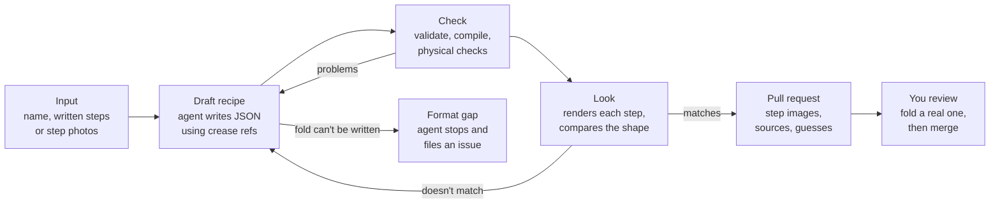

# Plane recipes written by an agent

Plan, 9 November 2026. Checked against the code at `a2f5240` (the Nakamura lock commit).

## Summary

The agent turns a plane's name, written steps or a diagram photo into a `.plane.json` recipe. It checks the recipe with crease until it folds cleanly, then opens a pull request for review. The first version is a command you run in Claude Code inside this repo: no backend, no API key in the app, and every recipe still goes through review.

**Why it's useful.** Today, adding a plane takes someone who knows the format and can picture each fold. The agent removes that bottleneck. Its failures also point straight at what the format still can't express.

**What the Nakamura lock taught us.** That recipe compiled and passed every physical check on the first try. Even so, the plane looked like a box until it was compared with photos of a real one. So the agent is mostly a feedback loop around the engine: write, check, look, compare, revise. What crease can tell the agent matters more than the prompt.

**Is it an agent?** Yes, but the agent loop itself comes from Claude Code, on your machine and in GitHub Actions. What we build is the tools (the `crease` commands below), the instructions (a `draft-plane` skill), and the triggers (the phases below).

## How it works

The agent cycles between drafting and crease's checks. It opens a pull request only when the recipe folds cleanly and matches the real plane.

Each round fixes one problem that crease reports. A round limit makes sure a stuck draft ends as a report rather than looping forever. If the format can't express a fold, the agent stops and files a gap instead of faking it.

## What crease needs to give the agent

The agent can only fix problems that crease tells it about. Most of the checking already exists inside the engine and the app. It needs to become commands with JSON output, one command per question the agent asks.

| Command | What the agent gets back | Today |
| --- | --- | --- |
| `crease validate` | Problems with the recipe's structure, step by step, in plain words with a suggested fix | Exists as `validatePlane` plus the JSON schema; needs a command and JSON output |
| `crease compile` | The first step that can't be folded and why, e.g. "Fold 1 doesn't move any paper" | Exists: `compilePlaneSoFar` returns the plane up to the failing step, with the step number; needs a command |
| `crease check` | Physical problems per step: torn paper, paper through paper or through the table, paper that isn't flat | Exists as `auditPlane` and runs on every compile, but compiling stops at the first problem; the command should list them all |
| `crease refs --step n` | Every corner, edge, crease and midpoint the agent can point at before step n | New. Stops the agent from inventing references that don't exist yet |
| `crease describe --step n` | A text readout of the paper after step n: layers, which flap is on top, outline size in cm, crease ids | New. Agents reason about shapes better from numbers than from pictures |
| `crease render` | One small SVG per step, top and side view, with no browser needed | Mostly there: `projectStep` already draws any step with fold lines and arrows, and the app's `Diagram` turns that into SVG. Needs an SVG writer that runs without React |
| `crease compare` | Wingspan, body depth and length of the finished plane against a reference | New. Catches the "compiles but looks like a box" case |

The same commands help when you write a recipe by hand, so none of this work is agent-only.

## What the agent starts from

The agent accepts four kinds of input, from easiest to hardest:

1. **A name**, like "Nakamura lock". The agent looks up published instructions and lists the pages it used, as the Nakamura commit did.
2. **Written steps** you paste in, from a book, a class or your own notes.
3. **Photos or a diagram** of each step. The agent reads them with vision, so results depend on how clear the pictures are.
4. **A video.** Later. Research on working out folding steps from videos is still early.

Every recipe records where it came from:

- `author`: the plane's designer, when known. The schema already has this field, but neither plane uses it yet.
- `sources` (new): the pages or books the agent used.
- `assumptions` (new): every guess it made, like reading "about an inch" as 2.5 cm on A4.

The agent writes step text in its own words, and crease draws every picture. Nothing is copied from a source's wording or diagrams.

## Where it runs

The same skill powers all three phases. Only the trigger changes, so each phase reuses everything learned in the one before.

| Phase | Who starts it | How it runs | What it needs | Move on when |
| --- | --- | --- | --- | --- |
| 1. In Claude Code | You, e.g. "draft a recipe for the Nakamura lock" | A `draft-plane` skill in `.claude/skills/` runs the crease commands, then opens a PR | The crease commands and a Claude plan. Nothing to host | 3 of the 5 test planes merge with only small edits |
| 2. GitHub issue to PR | Anyone files a "Request a plane" issue; you approve it with a `draft` label | The Claude Code GitHub Action runs the same skill and opens a PR with step images | An API key or subscription token as a repo secret, plus a turn limit and a timeout | Quality and cost per plane hold steady over about 10 requests |
| 3. In the app | People tap "Suggest a plane" | First, the button opens a prefilled GitHub issue, so there's no backend. Later, a small server function for people without GitHub accounts | Phase 2 working. The server version also needs rate limits and moderation | — |

- **Why the label.** By default, the Action only runs for people with write access, and issue text is untrusted input. Your label works as both approval and cost control. ([Claude Code GitHub Actions](https://code.claude.com/docs/en/github-actions))
- **Subscription or API key.** The Action accepts either. With a subscription token, runs count against your Claude plan rather than API billing. GitHub Actions minutes still apply.
- **Prefilled issues.** GitHub can prefill a new issue from URL parameters, including fields in an issue form. ([GitHub Docs](https://docs.github.com/en/issues/tracking-your-work-with-issues/creating-an-issue#creating-an-issue-from-a-url-query))
- **Phase 3 and the editor.** It pairs well with the authoring mode on the roadmap. You fix a draft that's almost right by tapping points on the paper, instead of running the agent again.
- **A custom agent, only if needed.** For app users without GitHub accounts, the server version would use the Claude Agent SDK with the same tools and skill.

## How we judge it

A good recipe folds cleanly, looks like the real plane and teaches clearly. Machines can check the first two. Only a person folding real paper can check the third.

**Test set: five planes, each testing something different.**

| Plane | What it tests | A pass looks like |
| --- | --- | --- |
| Classic dart | The baseline, already checked by hand | Same fold lines as the existing recipe |
| Nakamura lock | Wings folded parallel to the body, the lock fold, turning over before a fold | Same shape as the existing recipe, wing depth included |
| A beginner plane not in the hangar yet | A fresh recipe using only supported folds | Merges with small edits |
| A plane from your own photos | Photo input instead of a name | Matches your photos |
| A plane with a tail fin | A fold crease can't do yet (inside reverse) | The agent stops and reports the gap instead of faking it |

**What we measure on each run:**

- Whether it compiles first time, and how many rounds it needs to pass.
- Shape match: wingspan, body depth and length against the reference.
- Edits before merge: how many lines had to change.
- Clarity: whether you can fold a real one from the app's steps alone.
- Time and cost per plane.

**Review.** Every PR shows a strip of step images, the sources, the assumptions and any format gaps. Nothing merges until someone has folded a real one.

## Limits and risks

The biggest risk is a recipe that passes every check and is still wrong, as the Nakamura was at first.

| Risk | What we do about it |
| --- | --- |
| It compiles but doesn't look like the real plane | `crease compare`, side-by-side images in the PR, and a real fold before merging |
| It invents references or kinds of fold | `crease refs` lists what exists at each step, and validation rejects anything else |
| The format can't express a fold | The agent stops and files a "format gap" issue. It never edits crease; engine changes stay with a person |
| A web page or issue tries to steer the agent | Page and issue text count as data, not instructions. The agent writes only to `planes/` on a branch, and CI decides what's valid |
| Costs run away in Phase 2 | Runs start only after your label, with a turn limit and a timeout |
| Vague measurements | Every guess goes into `assumptions` and the PR description |

The engine also sets limits the agent can't get around. It only folds flat, rigid paper. Curved folds, and tucks it can't model yet, will show up as format gaps.

## Decisions and next steps

**Open decisions:**

- **Who is it for first?** Proposed: the maintainer as author (Phase 1). Public requests can wait until drafts are reliably good.
- **Can the agent change crease?** Proposed: no. It writes recipes only, and format gaps become issues.
- **Which three test planes join the dart and the Nakamura?** Pick ones with different folds, including one with a tail fin.
- **Photo input now or later?** Names and written steps are enough to learn from first.

**Next steps, in order:**

- [ ] Turn validate, compile and the physical checks into `crease` commands with JSON output
- [ ] Add `crease refs` and `crease describe`
- [ ] Write per-step SVGs from `projectStep`, without React
- [ ] Add `sources` and `assumptions` to the schema, and start filling in `author`
- [ ] Write the `draft-plane` skill: format guide, the loop, and the lessons from the Nakamura
- [ ] Run it on the five test planes and record the measures
- [ ] Add `crease compare` once the reference shapes exist
